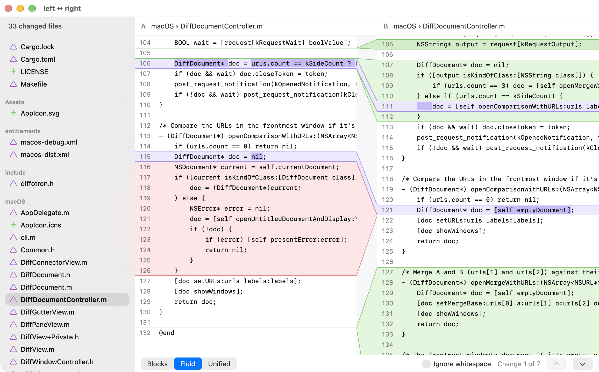

# Diff-o-tron 

A simple graphical text diffing and merging tool for macOS.

## Features

* Side-by-side diff showing text file changes, with blocks, fluid, and unified view.
* 3-way merge, with separate merge output pane on the bottom for conflict resolution and manual edits.
* Command-line helper tool to launch Diff-o-tron as diff tool and/or merge tool.

## Git configuration

After you run the following commands to configure Git,
you'll be able to use Diff-o-tron to diff changes in your Git repository
using `git dt`, and merge with `git mt`:

    git config --global difftool.diffotron.cmd '/Applications/Diff-o-tron.app/Contents/Helpers/diffotron --wait --label "$MERGED" "$LOCAL" "$REMOTE"'
    git config --global difftool.prompt false
    git config --global diff.tool diffotron
    git config --global alias.dt 'difftool -d'

    git config --global mergetool.diffotron.cmd '/Applications/Diff-o-tron.app/Contents/Helpers/diffotron --label "$MERGED" --output "$MERGED" "$BASE" "$LOCAL" "$REMOTE"'
    git config --global mergetool.diffotron.trustExitCode true
    git config --global mergetool.prompt false
    git config --global merge.tool diffotron
    git config --global alias.mt mergetool

## Building

You'll need either the Xcode Command Line Tools or Xcode itself to build,
and a working rust compiler.

    make
    make CONFIG=release

If you get warnings about macOS version mismatches, use this instead:

    make BUILD_STD=1

## Thanks

I'd like to thank [Dan Davison](https://github.com/dandavison)
for his excellent [git-delta](https://github.com/dandavison/delta) tool,
and its contributors, which Diff-o-tron uses a piece of.

## License

MIT.
